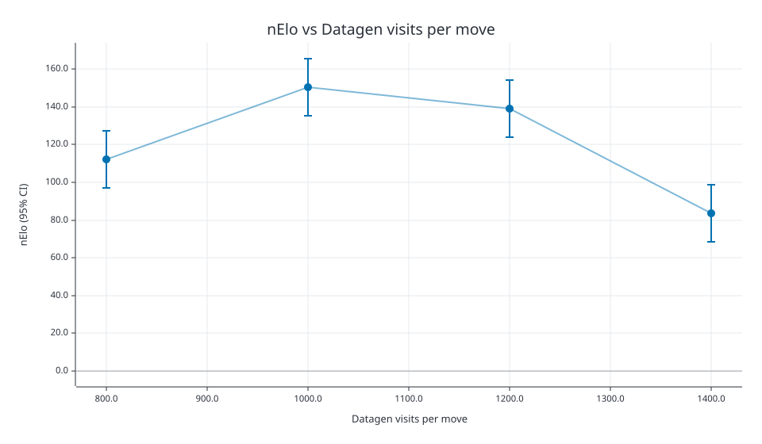

# Datagen visits sweep

Compare 800, 1,000, 1,200, and 1,400 self-play visits within a 65-minute budget, reinvesting cheaper generation in more unique positions at **15 epochs**.

Generated fresh data for every arm, including 1,200 visits, and trained each candidate from scratch. Each played a fixed match of **1,000 game pairs** against the pre-sweep baseline, with the same opening-book seed and 800 evaluation visits per move after matched-speed validation.

| Datagen visits | Training positions | Steps | Policy loss | WDL loss | Total loss | Training runtime (s) | Generation charge (s) | Budget (s) |
|---:|---:|---:|---:|---:|---:|---:|---:|---:|
| 800 | 431,115 | 50,535 | 2.0627 | 0.7542 | 2.8169 | 432.11 | 3477.16 | 3909.27 |
| 1000 | 350,821 | 41,115 | 2.0688 | 0.7900 | 2.8587 | 351.29 | 3547.74 | 3899.03 |
| 1200 | 293,939 | 34,455 | 2.0827 | 0.7441 | 2.8269 | 286.01 | 3604.96 | 3890.97 |
| 1400 | 254,743 | 29,865 | 2.0744 | 0.7308 | 2.8051 | 249.20 | 3651.42 | 3900.62 |

Losses use each arm's held-out games.

| Datagen visits | W/D/L | nElo (95% CI) |
|---:|---|---|
| 800 | 826/820/354 | +112.1 (+96.9, +127.4) |
| 1000 | 913/767/320 | +150.3 (+135.1, +165.5) |
| 1200 | 894/785/321 | +139.2 (+124.0, +154.4) |
| 1400 | 799/774/427 | +83.7 (+68.4, +98.9) |

Promoted the **1,000-visit candidate**, which had the highest observed nElo. Carry forward **350,821 training positions and 15 epochs**. Its lead over the fresh 1,200-visit candidate is uncertain; their confidence intervals overlap.

Artifacts: `/data/chess/chess-engine-5/models/visits-sweep-2026.11.13`.
