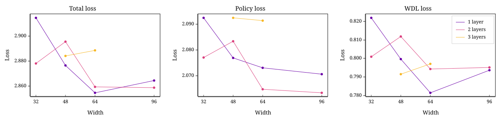
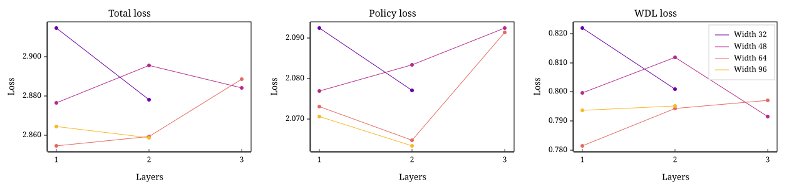
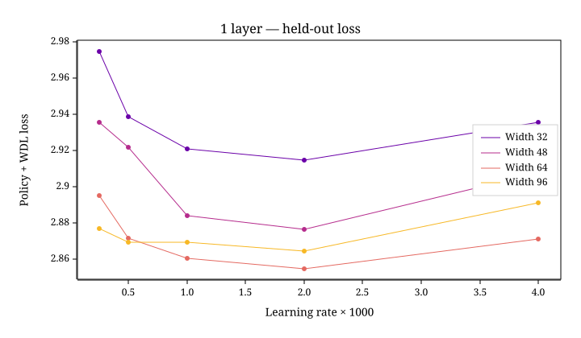
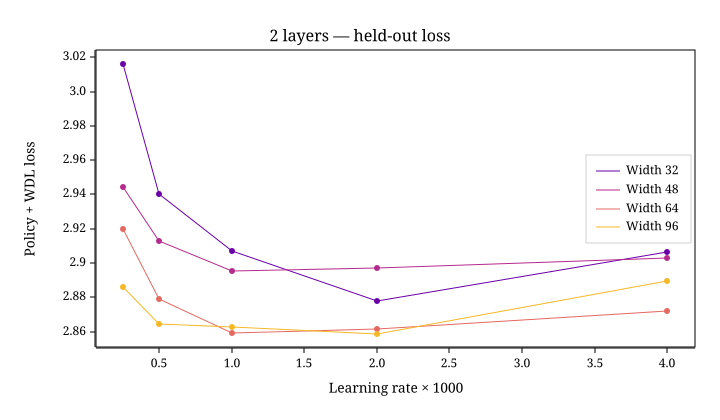
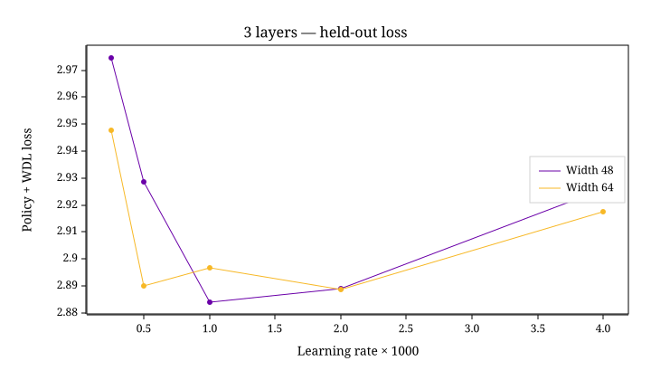

# Architecture and learning-rate sweep

Find a stronger model within the 60-minute budget by jointly sweeping transformer depth, width, and learning rate.

Trained 50 combinations: 10 shapes × 5 learning rates. FFN width scales as twice the model width. Each shape uses 323,849 positions, with epochs calibrated to fill the remaining budget after the 3,274.99s generation charge.

Total held-out loss is policy loss + WDL loss. Bold cells mark the best rate for each shape.

| Layers | Width | Epochs | LR 0.00025 | LR 0.0005 | LR 0.001 | LR 0.002 | LR 0.004 |
|---:|---:|---:|---:|---:|---:|---:|---:|
| 1 | 32 | 15.01 | 2.9747 | 2.9387 | 2.9207 | **2.9145** | 2.9354 |
| 1 | 48 | 14.77 | 2.9356 | 2.9218 | 2.8837 | **2.8765** | 2.9075 |
| 1 | 64 | 15.16 | 2.8948 | 2.8716 | 2.8603 | **2.8545** | 2.8711 |
| 1 | 96 | 14.99 | 2.8767 | 2.8694 | 2.8690 | **2.8644** | 2.8909 |
| 2 | 32 | 9.35 | 3.0161 | 2.9404 | 2.9068 | **2.8781** | 2.9066 |
| 2 | 48 | 9.26 | 2.9443 | 2.9126 | **2.8953** | 2.8973 | 2.9031 |
| 2 | 64 | 9.41 | 2.9196 | 2.8788 | **2.8592** | 2.8618 | 2.8718 |
| 2 | 96 | 9.27 | 2.8859 | 2.8646 | 2.8628 | **2.8586** | 2.8894 |
| 3 | 48 | 6.62 | 2.9746 | 2.9286 | **2.8840** | 2.8890 | 2.9259 |
| 3 | 64 | 6.78 | 2.9477 | 2.8899 | 2.8966 | **2.8886** | 2.9176 |

| Best at each depth | Width | Learning rate | Policy loss | WDL loss | Total loss |
|---|---:|---:|---:|---:|---:|
| Baseline | 64 | 0.001 | 2.0721 | 0.7997 | 2.8718 |
| 1 layer | 64 | 0.002 | 2.0731 | 0.7814 | 2.8545 |
| 2 layers | 96 | 0.002 | 2.0634 | 0.7952 | 2.8586 |
| 3 layers | 48 | 0.001 | 2.0925 | 0.7915 | 2.8840 |

Selected **1 layer, width 64, learning rate 0.002** for the lowest total loss. The best two-layer model improved policy loss further, but had higher WDL loss.

Timed training ranged from 318.02–338.40s; charged generation was 3,274.99s per run, giving totals of 3,593.01–3,613.39s. The selected run used 323.46s + 3,274.99s = **3,598.45s**.

[Full per-run measurements](results.csv).

## Gainer match

Gainer SPRT [0, 20] nElo **failed** after **669 game pairs**, with both models at 800 visits per move. Inference measured 2.135 ms baseline / 2.134 ms candidate at batch 512.

- W/D/L **389/550/399**
- nElo **0.0 (−19.4, +20.2)**, 95% CI

Kept the existing baseline and training recipe.

Each point uses the run with the lowest total loss for that width/layer combination; the same selected run supplies all three panels.

Artifacts: `/data/chess/chess-engine-5/models/architecture-sweep-2026.11.14`.
