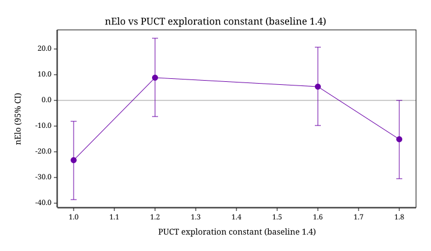

# Search exploration

Sweep the PUCT exploration constant during play against the incumbent 1.4. All candidates used the [baseline checkpoint](../2026.11.21-13-subtree-reuse/README.md), the same 1,000 opening pairs (seed 42), subtree reuse, and 800 total root visits per move.

| Exploration | W/D/L | nElo vs. 1.4 (95% CI) |
|---:|---:|---:|
| 1.0 | 596/704/700 | -23.3 (-38.6, -8.1) |
| 1.2 | 691/656/653 | +8.8 (-6.4, +24.1) |
| 1.6 | 676/672/652 | +5.4 (-9.8, +20.6) |
| 1.8 | 613/705/682 | -15.2 (-30.4, +0.0) |

**Kept 1.4.** Exploration 1.2 had the highest gauntlet estimate. On a fresh opening seed (43), its [0, 15] nElo gainer failed after 1,210 pairs, with candidate W/D/L 792/822/806 and −0.1 nElo (−14.7, +15.1), 95% CI.
