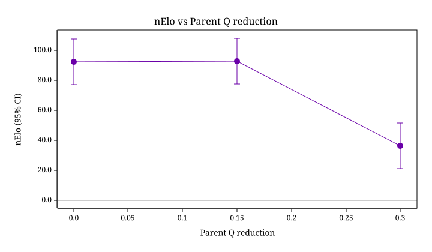

# First-play urgency

Test whether an unvisited move should inherit the parent’s Q, with a fixed reduction. The baseline assigns zero. The candidate uses the parent’s observed mean, or its network value before the root has outgoing visits, and floors the result at −1.

Each candidate played the same 1,000 opening pairs against the incumbent search (seed 101, 800 total root visits per move, subtree reuse).

| Candidate | W/D/L | nElo (95% CI) |
|---|---:|---:|
| parent-0.00 | 868/678/454 | +92.2 (+77.0, +107.4) |
| parent-0.15 | 871/670/459 | +92.5 (+77.3, +107.8) |
| parent-0.30 | 754/660/586 | +36.5 (+21.2, +51.7) |

The [0, 15] nElo gainer for **parent-0.15** on seed 102 **passed** after 500 pairs. Candidate W/D/L 390/351/259, nElo +59.0 (+37.5, +80.6), 95% CI.

Promoted **parent-0.15**.
