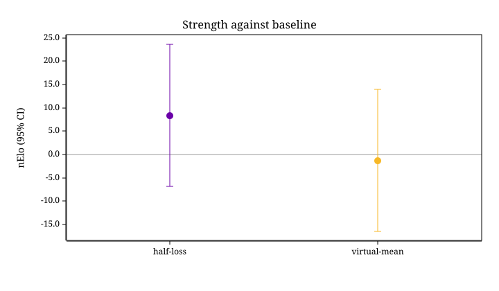

# Value of pending visits

Test how four-leaf batched search should score a visit while inference is pending. Full loss assigns −1 from the selecting player’s perspective. Half loss assigns −0.5. Virtual mean preserves the branch’s observed Q. All three reserve the visit in the exploration denominator.

Each candidate played the same 1,000 opening pairs against the incumbent search (seed 111, 800 total root visits per move, subtree reuse).

| Candidate | W/D/L | nElo (95% CI) |
|---|---:|---:|
| half-loss | 694/645/661 | +8.3 (-6.9, +23.6) |
| virtual-mean | 686/622/692 | -1.3 (-16.5, +13.9) |

The [0, 15] nElo gainer for **half-loss** on seed 112 **failed** after 201 pairs. Candidate W/D/L 119/123/160, nElo -50.3 (-85.0, -15.5), 95% CI.

Kept the baseline.
