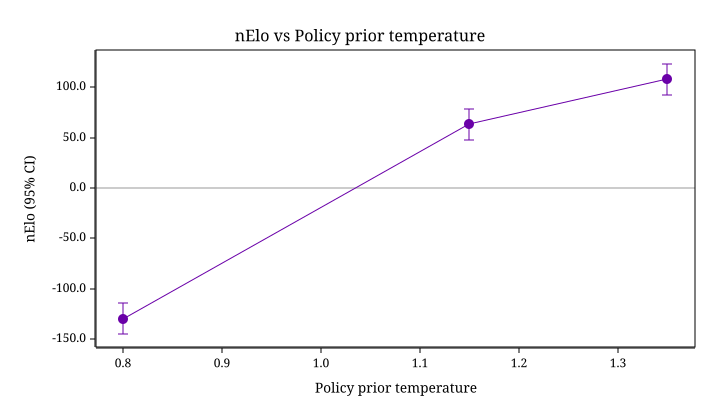

# Search prior temperature

Test whether rescaling legal move priors before tree search improves playing strength. Each candidate normalizes probabilities raised to the reciprocal of its temperature. All players select the most visited move.

Each candidate played the same 1,000 opening pairs against the incumbent search (seed 121, 800 total root visits per move, subtree reuse).

| Candidate | W/D/L | nElo (95% CI) |
|---|---:|---:|
| 0.80 | 393/642/965 | -129.5 (-144.8, -114.3) |
| 1.15 | 813/656/531 | +63.2 (+47.9, +78.4) |
| 1.35 | 922/629/449 | +107.7 (+92.5, +123.0) |

The [0, 15] nElo gainer for **1.35** on seed 122 **passed** after 500 pairs. Candidate W/D/L 460/301/239, nElo +95.7 (+74.2, +117.3), 95% CI.

Promoted **1.35**.
