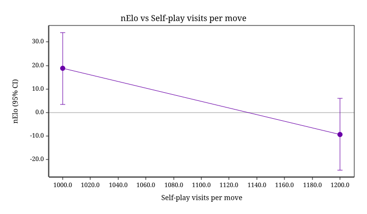

# Self-play depth with subtree reuse

Test whether deeper search labels justify training on fewer unique positions. All three depths used the same teacher (`/data/chess/chess-engine-5/models/2026.11.21-13-subtree-reuse/candidate`), generation settings, 15 epochs, and 60-minute budget. Losses were scored on each dataset’s own holdout.

| Self-play visits | Unique positions | Epochs | Training (s) | Charged generation (s) | Budget (s) | Policy loss | WDL loss | Total loss |
|---|---:|---:|---:|---:|---:|---:|---:|---:|
| 800 | 1,215,100 | 15 | 1040.3 | 2567.0 | 3607.3 | 1.6328 | 0.6519 | 2.2847 |
| 1000 | 1,042,600 | 15 | 890.7 | 2708.0 | 3598.7 | 1.6429 | 0.6497 | 2.2926 |
| 1200 | 918,800 | 15 | 775.3 | 2813.9 | 3589.2 | 1.6507 | 0.6450 | 2.2958 |

Fixed gauntlet against the current playing baseline on the same 1,000 opening pairs (seed 141, 800 match visits per side).

| Self-play visits | W/D/L | nElo (95% CI) |
|---:|---:|---:|
| 1000 | 807/479/714 | +18.8 (+3.5, +34.0) |
| 1200 | 756/443/801 | -9.3 (-24.6, +5.9) |

The promoted 800-visit checkpoint was the gauntlet baseline.

The [0, 15] nElo gainer for **1000 visits** on seed 142 **passed** after 500 pairs. Candidate W/D/L 422/233/345, nElo +29.3 (+7.7, +50.8), 95% CI.

Promoted 1000-visit self-play.
