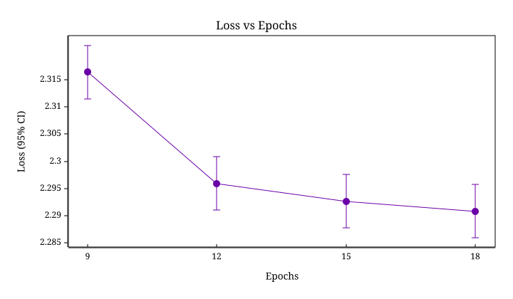

# Epochs versus positions with subtree reuse

Reallocate the 60-minute budget between unique positions and repeated training on the incumbent’s 1,000-visit dataset. All arms used the same 1,150 held-out games (156,468 positions).

| Epochs | Unique positions | Training (s) | Charged generation (s) | Budget (s) | Policy loss | WDL loss | Total loss |
|---|---:|---:|---:|---:|---:|---:|---:|
| 9 | 1,157,700 | 594.3 | 3006.9 | 3601.2 | 1.6635 | 0.6529 | 2.3164 |
| 12 | 1,097,500 | 740.2 | 2850.6 | 3590.8 | 1.6466 | 0.6494 | 2.2960 |
| 15 | 1,042,600 | 890.7 | 2708.0 | 3598.7 | 1.6429 | 0.6497 | 2.2926 |
| 18 | 994,000 | 1014.3 | 2581.8 | 3596.1 | 1.6418 | 0.6490 | 2.2908 |

Error bars use the baseline’s run-to-run standard deviation to estimate a 95% interval around each single-run loss. The lowest measured loss was at 18 epochs.

The [0, 15] nElo gainer for **18 epochs** on seed 151 **passed** after 707 pairs. Candidate W/D/L 575/350/489, nElo +22.2 (+3.0, +41.0), 95% CI.

Promoted 18 epochs.
