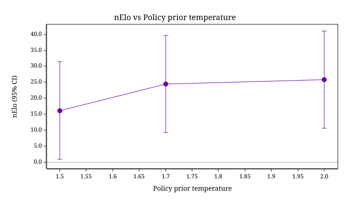

# Softer search priors

Test whether search benefits from further softening the policy prior after the softest setting in the previous sweep won.

Each candidate played the same 1,000 opening pairs against the incumbent search (seed 191, 800 total root visits per move, subtree reuse).

| Candidate | W/D/L | nElo (95% CI) |
|---|---:|---:|
| 1.50 | 739/594/667 | +16.1 (+0.9, +31.4) |
| 1.70 | 768/576/656 | +24.4 (+9.2, +39.7) |
| 2.00 | 784/553/663 | +25.8 (+10.6, +41.0) |

The [0, 15] nElo gainer for **2.00** on seed 192 **passed** after 892 pairs. Candidate W/D/L 698/477/609, nElo +18.5 (+1.2, +35.2), 95% CI.

Promoted **2.00**.
